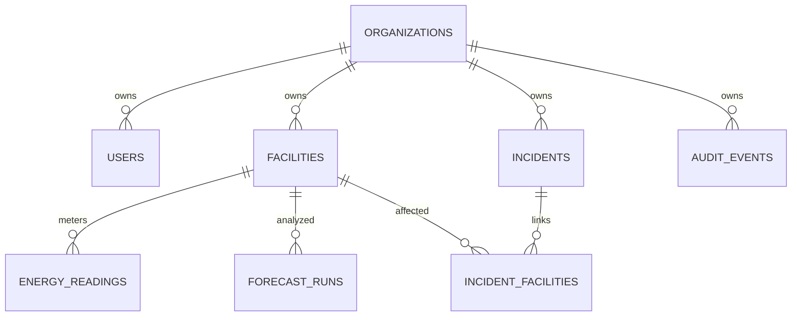

# Architecture

GridPulse is a modular monolith with a separately built static React client. This keeps database transactions local and makes the boundary between HTTP, SQL, and statistical computation explicit.

## Request lifecycle

1. Middleware assigns an untrusted-input-independent request ID, rate limits the actual network client, and emits structured duration/status logs.
2. JWT validation checks algorithm, issuer, audience, subject, issue time, and expiration. Server records resolve the user's current organization, role, and active flag.
3. Dependencies create one async SQLAlchemy session and a tenant-scoped repository per request.
4. Pydantic validates input, including aware time ranges. Services compose repository queries with pure functions in `app/services/analytics.py`.
5. Mutations commit their audit record in the same transaction. Failures roll back when the request session closes.

## Data model

Facility codes are unique **within** an organization. A `(facility_id, timestamp)` uniqueness constraint enforces one hourly observation per site. Composite foreign keys pair resource ID with organization ID, preventing cross-tenant reading, forecast, or incident-site relationships even when a writer makes a mistake.

Reading indexes cover `(organization_id, timestamp)` and `(organization_id, facility_id, timestamp)`. These support fleet-period and individual-site-period scans. Incident status and audit/forecast creation indexes begin with organization ID. The incident query groups affected-site counts in one outer join; it does not issue a separate query per incident.

Alembic revisions contain explicit DDL independent of future ORM edits. Schema changes are a release step. The web process does not call `metadata.create_all()`. The isolated test fixture uses metadata to reset its disposable database; CI separately verifies actual migrations, downgrade, upgrade, and schema drift.

## Time and missing data

PostgreSQL timestamps are timezone aware. Intervals use inclusive start and exclusive end. Each stored kW reading is a one-hour **mean**, so summing readings gives observed kWh. The app displays coverage to distinguish observed energy from a complete-period estimate. Fleet demand requires all selected sites at an hour; site anomaly checks use their own history so a local spike is not diluted by aggregation.

Anomaly queries load an earlier warmup interval and exclude it from returned observations. Missing hourly intervals become null; anomaly windows reset on gaps and forecasts reject nonconsecutive history. The final 24 hours of forecast history are held out without feedback during evaluation.

## Frontend boundaries

TanStack Query manages remote data, requests, cancellation, and cache invalidation. React state holds current filters and form parameters. Session changes cancel in-flight requests and clear the prior tenant's cached operational data. Credentials stay in memory; reloading starts a new demo session.

React Router uses hash routes for GitHub Pages compatibility. Analytical routes are loaded on demand, keeping Recharts out of the landing page's initial JavaScript. SCSS Modules scope component styling; global styles provide typography, form controls, keyboard focus, and reduced-motion behavior.

## Deployment boundaries

The static client receives only the API URL and public repository URL at build time. Database and signing secrets belong exclusively to the backend's environment/secret store. Production CORS accepts explicit HTTPS origins. Readiness queries the migration table; liveness checks only the process. Documentation routes and public demo identity creation remain public, while data routes require a signed identity.
